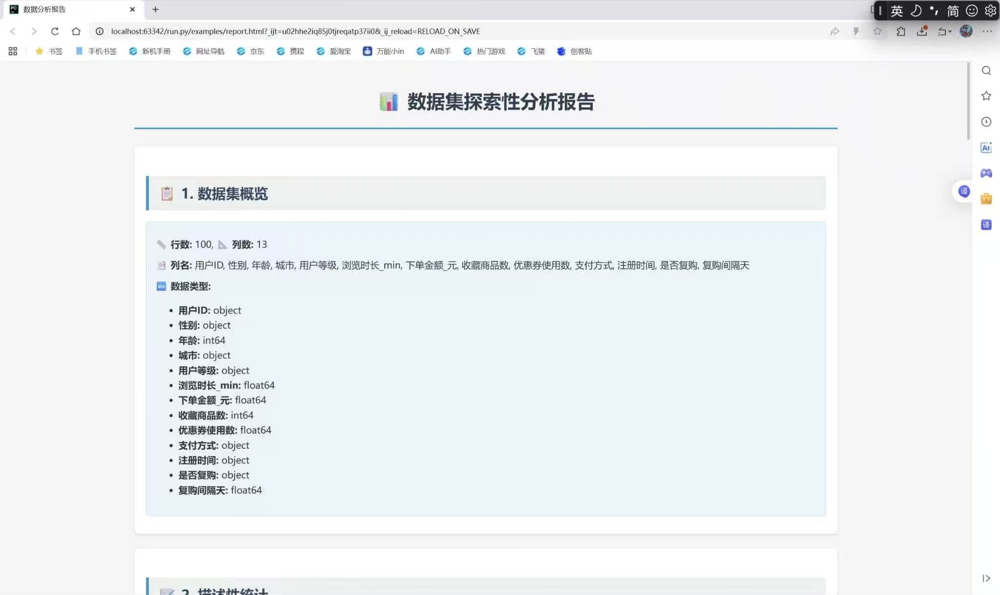
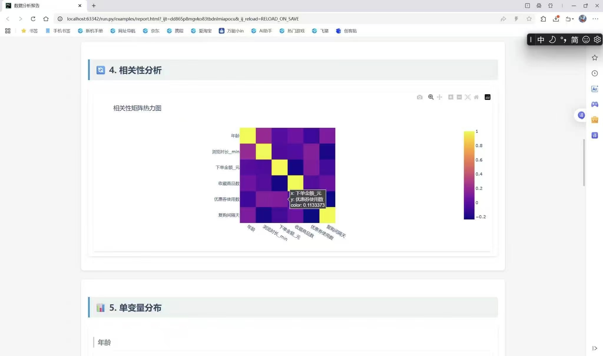
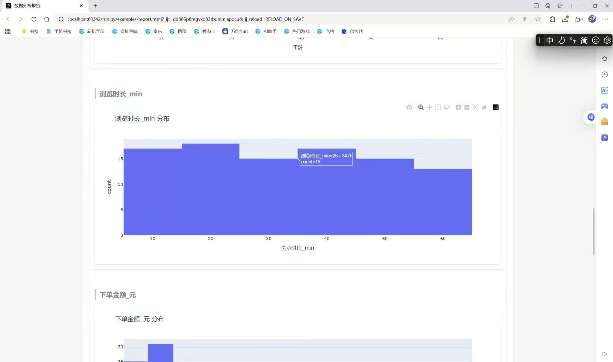
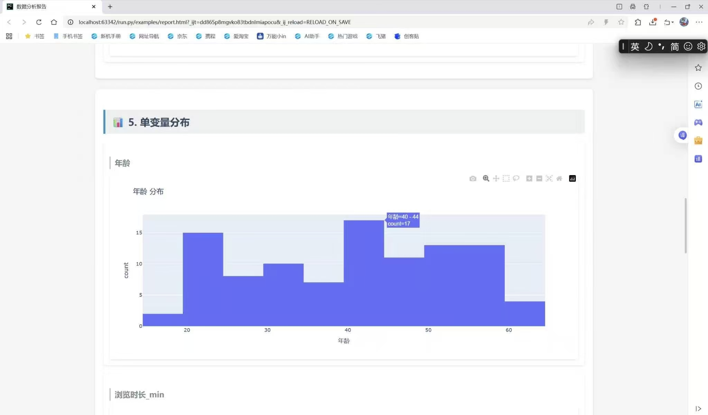

# Data Explorer Toolkit

> 一行代码，自动生成交互式数据分析报告 —— 专为快速探索性数据分析（EDA）设计。

[](https://www.python.org/downloads/)
[](LICENSE)

## 📌 项目简介

**Data Explorer Toolkit** 是一个轻量级的 Python 工具包，能够自动读取 CSV/Excel 数据，一键生成包含统计摘要、缺失值分析、相关性矩阵和交互式可视化的 HTML 报告。

本项目**不依赖任何公开数据集**，而是使用 `numpy` + `pandas` 自行构造了一套模拟数据（位于 `examples/sample_data.csv`），该数据模拟了**上海某商圈的数据运营场景**（包含客流量、促销活动、天气等字段），既能完整演示工具功能，又避免了数据合规问题。


## ✨ 功能特点

- **一键生成报告**：仅需一行代码，输出完整的 HTML 报告。
- **自动统计分析**：数据集概览、描述性统计、缺失值热力图。
- **交互式可视化**：基于 Plotly 实现可缩放、可悬停查看详情的图表（相关性矩阵、单变量分布图等）。
- **灵活数据输入**：支持 CSV、Excel（需 `openpyxl`）格式。
- **可扩展模板**：使用 Jinja2 模板，方便自定义报告样式。

## 🛠 技术栈

| 类别       | 库                                                |
| ---------- | ------------------------------------------------- |
| 数据处理   | Pandas, NumPy                                     |
| 可视化     | Matplotlib, Plotly                                |
| 报告模板   | Jinja2                                            |
| 测试       | Pytest                                            |
| 数据生成   | Python 标准库 + NumPy                              |

## 📊 示例数据（自生成）

为了示范工具能力并保护隐私，本项目**不包含真实业务数据**，而是使用脚本生成了一套模拟数据集 `examples/sample_data.csv`，主要字段如下：

| 字段名             | 类型   | 说明                       |
| ------------------ | ------ | -------------------------- |
| `date`             | 日期   | 2024-01-01 ~ 2024-01-31    |
| `daily_visitors`   | 整数   | 日客流量（含部分缺失值）    |
| `temperature`      | 浮点数 | 当日平均温度（℃）           |
| `is_promotion`     | 整数   | 是否促销（0/1）            |
| `holiday`          | 整数   | 是否为节假日（0/1）         |

你可以直接运行示例脚本查看分析报告，也可以轻松替换为自己的数据文件。

## 🚀 快速开始

### 环境要求
- Python 3.8+
- pip

### 安装依赖
```bash
git clone https://github.com/Sylvia-helper/data-explorer-toolkit.git
cd data-explorer-toolkit
pip install -r requirements.txt
运行示例

```bash
cd examples
python example_usage.py
```

成功后会生成 report.html，用浏览器打开即可查看交互式报告。

使用自己的数据

```python
from data_explorer import generate_report

generate_report('你的数据.csv', output_path='my_report.html')
```

🎬 演示

一键运行生成报告

https://b23.tv/Zzt04cK

从命令行执行 python example_usage.py 到报告自动生成并在浏览器打开的全过程。

交互式图表（悬停与缩放）

https://b23.tv/rxI8FO5

Plotly 图表支持鼠标悬停显示数值、框选缩放、图例筛选等交互操作。

📸 报告预览

缺失值热力图 相关性矩阵 单变量分布图




💡 所有图表均为 Plotly 交互式图形，你可以在浏览器中缩放、悬停、下载为图片。

🧪 测试

本项目使用 pytest 进行单元测试。在项目根目录下运行：

```bash
pytest tests/
```

🤝 贡献指南

欢迎提交 Issue 或 Pull Request。请确保新增代码通过所有测试，并更新相关文档。

📄 许可证

本项目采用 MIT 许可证。

📧 联系

项目作者：Sylvia-helper
如有问题或建议，欢迎通过 GitHub Issues 联系。
